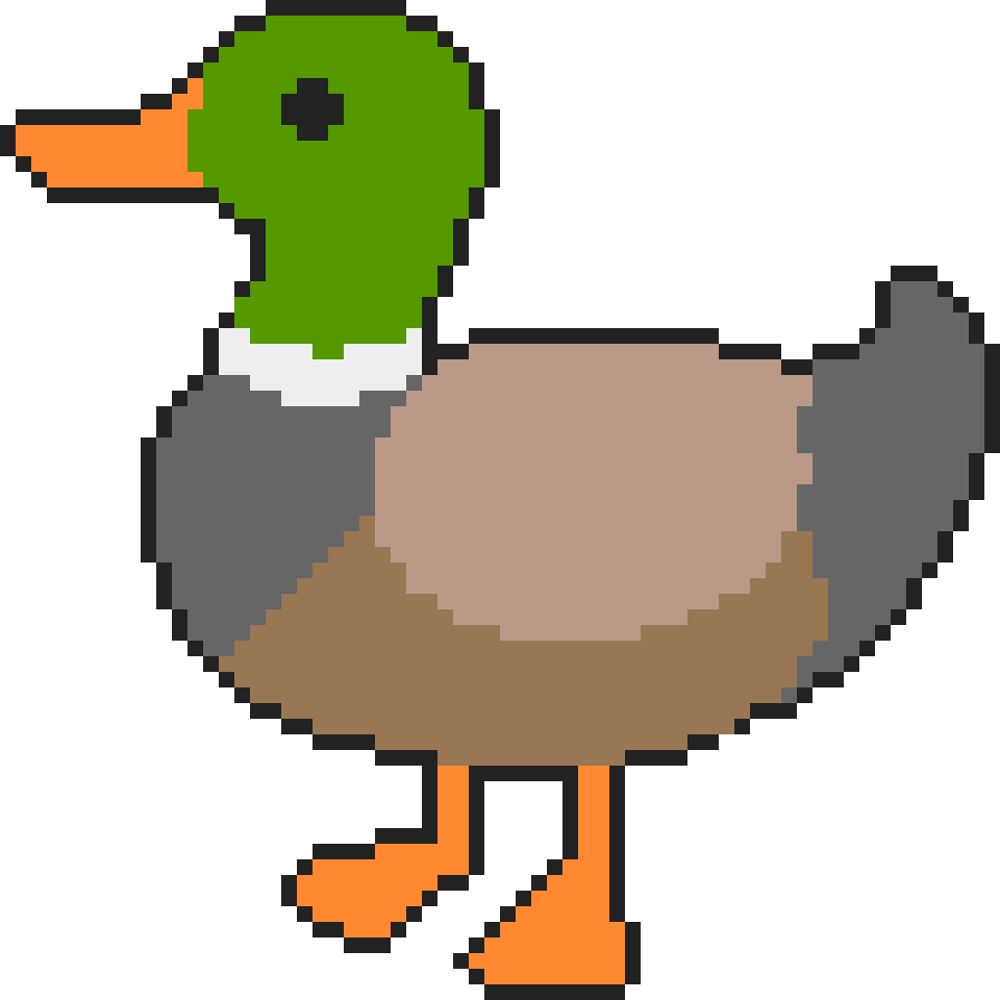

# 🧩 **JH-Toolkit — Conceptual Module Overview**

📁 **Module:** `<jh/concepts>`  
📦 **Namespace** `jh::concepts`  
📍 **Location:** `jh/conceptual/`  
📅 **Version:** 1.4.x (2026)  
👤 **Author:** JeongHan-Bae `<mastropseudo@gmail.com>`

  

## 🧭 Introduction

`jh::concepts` defines the **behavioral foundation layer** of the JH-Toolkit —
a centralized system for **duck-typed semantic recognition**.

Unlike functional modules such as `jh::async`, which extend features outward,
`jh::concepts` evolves *inward* — continuously absorbing and unifying
behavioral models across the entire toolkit.

Its design follows JH-Toolkit's **duck typing philosophy**:

> 🦆 *"If a type behaves like one, it is treated as one."*

This layer provides the **behavioral definition base** used by all higher-level systems:  
iteration, range adaptation, container construction, structural hashing, and synchronization.

---

## 🔹 Core Components

| Component                                           | Header                                    | Status   | Description                                                                                                           |
|-----------------------------------------------------|-------------------------------------------|----------|-----------------------------------------------------------------------------------------------------------------------|
| [`iterator`](iterator.md)                           | `<jh/conceptual/iterator.h>`              | ✅ Stable | Defines behavioral iterator concepts (`input_iterator`, `forward_iterator`, etc.) through pure expression validation. |
| [`sequence`](sequence.md)                           | `<jh/conceptual/sequence.h>`              | ✅ Stable | Defines duck-typed sequence recognition and `jh::to_range()` bridging to `std::ranges::range`.                        |
| [`tuple_like`](tuple_like.md)                       | `<jh/conceptual/tuple_like.h>`            | ✅ Stable | Detects and validates tuple-compatible types following the structured binding protocol.                               |
| [`range_traits`](range_traits.md)                   | `<jh/conceptual/range_traits.h>`          | ✅ Stable | Provides cross-domain range utilities and storage traits for views and adaptors.                                      |
| [`container_traits`](container_traits.md)           | `<jh/conceptual/container_traits.h>`      | ✅ Stable | Defines unified container value-type deduction for range–container compatibility.                                     |
| [`closable_container`](closable_container.md)       | `<jh/conceptual/closable_container.h>`    | ✅ Stable | Describes direct, deterministic construction of containers from ranges.                                               |
| [`collectable_container`](collectable_container.md) | `<jh/conceptual/collectable_container.h>` | ✅ Stable | Defines incremental population models for range-to-container materialization.                                         |
| [`hashable`](hashable.md)                           | `<jh/conceptual/hashable.h>`              | ✅ Stable | Provides unified semantic hashing detection (STL, ADL, member).                                                       |
| [`mutex_like`](mutex_like.md)                       | `<jh/conceptual/mutex_like.h>`            | ✅ Stable | Defines structural synchronization and lock-like behavioral traits.                                                   |
| [`pod_concepts`](pod_concepts.md)                   | `<jh/conceptual/pod_concepts.h>`          | ✅ Stable | Aggregates POD-related concepts and constants exposed under `jh::concepts`.                                           |

---

## 🧩 Evolution Path

| Characteristic       | Description                                                                                                                                                             |
|----------------------|-------------------------------------------------------------------------------------------------------------------------------------------------------------------------|
| **Expansion model**  | Continuous absorption — new behavioral predicates are gradually unified here.                                                                                           |
| **Predictability**   | Grows organically as new semantics are standardized; no predeclared roadmap.                                                                                            |
| **Long-term vision** | Serve as the single, toolkit-wide *behavioral definition layer* unifying all semantic checks (iteration, range adaptation, container bridging, hashing, locking, etc.). |
| **Compatibility**    | Fully backward-compatible with 1.3.x releases; 1.4.x modules reference `<jh/concepts>` as the canonical base.                                                           |

---

## 🧩 Module Summary

`jh::concepts` forms the JH-Toolkit's **behavioral semantics layer** —
an ever-growing foundation that recognizes types by *behavior* rather than *declaration*.

---

## 🧭 Navigation

|               Resource               |                                                                     Link                                                                     |
|:------------------------------------:|:--------------------------------------------------------------------------------------------------------------------------------------------:|
|        🏠 **Back to README**         |                                  |
|       📘 **Go to `iterator`**        |                     |
|       📗 **Go to `sequence`**        |                     |
|      📙 **Go to `tuple_like`**       |                         |
|     📘 **Go to `range_traits`**      |                             |
|   📗 **Go to `container_traits`**    |                 |
|  📙 **Go to `closable_container`**   |           |
| 📘 **Go to `collectable_container`** |  |
|       📗 **Go to `hashable`**        |                                           |
|      📙 **Go to `mutex_like`**       |                              |
|     📘 **Go to `pod_concepts`**      |                             |
